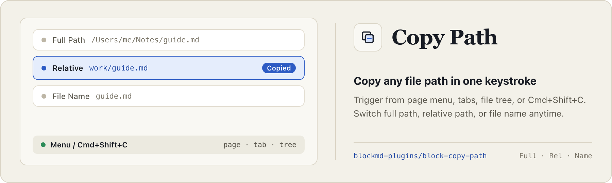

<picture>
  <source media="(prefers-color-scheme: dark)" srcset="assets/card-en-dark.png">
  <source media="(prefers-color-scheme: light)" srcset="assets/card-en-light.png">
  
</picture>

Just like VS Code's "Copy Path", this plugin lets you copy the computer path or file name of any note or folder in one step, ready to paste into a terminal, script, or AI assistant.

- **Copy from anywhere**: Trigger it from the page "..." menu, tab right-click menu, sidebar right-click menu (for notes and folders), or press `Cmd+Shift+C`.
- **Three formats with live preview**: Choose between Full path, Relative path within your notebook, or File name, and preview the exact output in plugin settings.
- **Works outside notebooks**: Any standalone file opened in Block can be copied too; when Relative path is selected, it falls back to the full path.

**Install**: Open Block Settings -> App Store and search **Copy Path**, or enter `blockmd-plugins/block-copy-path`.
