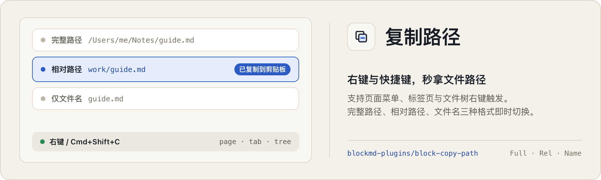

<picture>
  <source media="(prefers-color-scheme: dark)" srcset="assets/card-zh-dark.png">
  <source media="(prefers-color-scheme: light)" srcset="assets/card-zh-light.png">
  
</picture>

像 VS Code 里的「Copy Path」一样，一键复制笔记或文件夹在电脑里的路径或文件名，方便直接粘贴给终端、脚本或 AI 助手。

- **随手就能复制**：在页面右上角「…」菜单、标签页右键、侧栏文件树右键（笔记和文件夹都支持），或直接按 `Cmd+Shift+C` 都能触发。
- **三种常用格式**：支持完整路径、笔记本内的相对路径和纯文件名，在插件设置页切换时下方会实时预览复制效果。
- **笔记本外也可用**：用 Block 直接打开的外部文件同样可以复制路径；若选了「相对路径」，外部文件会自动复制为完整路径。

**安装**：打开 Block「设置 → 应用商店」搜索 **复制路径**，或手动填入 `blockmd-plugins/block-copy-path`。
